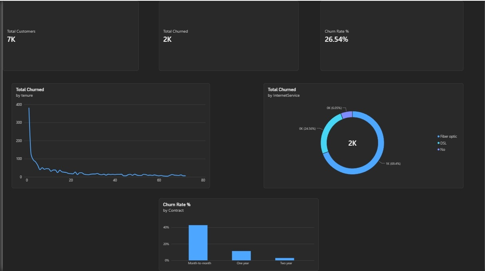

# Telco Customer Churn Analysis

## Overview
An end-to-end data analytics project investigating customer churn patterns for a telecommunications company. The goal was to identify high-risk customer segments and provide data-driven recommendations to improve retention.

## Tech Stack
* **Python (Pandas):** Data cleaning, missing value handling, data type conversion.
* **SQL (SQLite via Python):** Exploratory Data Analysis and metric calculations.
* **Power BI:** Interactive dashboard design and visual storytelling.

## Key Insights
* **Contract Type:** Month-to-month contracts experience significantly higher churn rates compared to annual or two-year contracts.
* **Tenure:** Customer attrition is highest during the first 12 months.
* **Internet Service:** Fiber optic users make up a major share of total churned volume.

## Dashboard Preview

